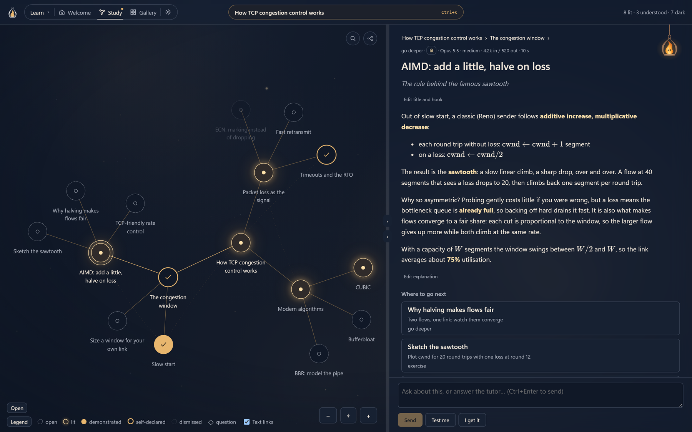
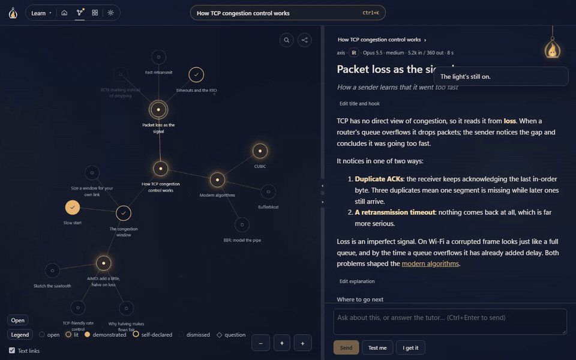
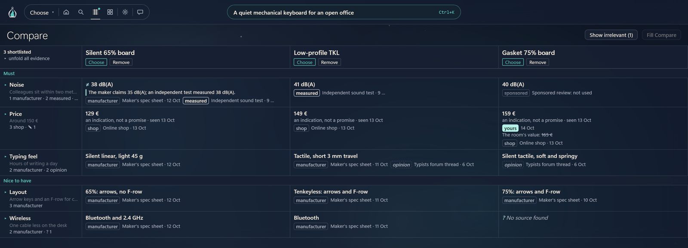

<div align="center">

<picture>
  <source media="(prefers-color-scheme: dark)" srcset="docs/images/mark-dark.png">
  
</picture>

# Lantern

**Light up what you're working through.**

A desktop workspace for thinking with an AI, not just asking it things.

   

**[Try the Learn room in your browser →](https://alexandreprothin.github.io/lantern/)**<br>
<sub>A free web demo with prepared answers: no sign-in, nothing leaves your browser.</sub>

</div>

You bring a subject (something to learn, a question to reason through, a decision to
make) and Lantern builds it up with you as a **graph of ideas** you can see, walk and
come back to, instead of a chat log that scrolls away.

<p align="center">
  
</p>

## Why

A chat window is a poor place to learn or think. The structure you build during a
session (what depends on what, what you already understand, what is still open) stays in
your head or gets lost in the scroll, the next session starts from zero, and the AI leans
toward handing over answers when doing the work yourself is often the point.

- **A graph, not a transcript.** Every concept, question and open end is a node. The
  conversation feeds the graph; the graph is what stays.
- **You do the work.** In Learn, the AI teaches, questions and pushes back rather than
  handing over conclusions.
- **Sessions persist.** A subject is saved to disk in a readable format. Reopen it, pick
  up where you left off, and watch it grow.

## Learn

Learn is where Lantern started, and the room to try first. Name a subject and the tutor
lights it one node at a time: an explanation, the axes worth exploring next, and a
dialogue where you answer, ask, or say *test me*. A node goes from **open** to **lit**
to **understood**, shown in the dialogue or declared with *I get it*, so the graph
doubles as a map of what you know.

<p align="center">
  
</p>

## Rooms

A room sets the mode of work: the AI's role, what the graph's nodes mean, and what
progress looks like. Each room has its own colour; the lantern (your subject and the AI)
is the same in all of them.

| Room | The AI acts as | Since |
|---|---|---|
| **Learn** | a tutor: concepts, prerequisites, what you've shown you understand | v0.1.0 |
| **Choose** | a researcher and adviser: your needs, ranked criteria, sourced and dated product facts, a shortlist; the pick stays yours | v0.3.0 |

<p align="center">
  
</p>

More rooms (Think, Explore, Interview) are planned; see the
[roadmap](agent_wiki/plans/roadmap.md).

**Amber**, Lantern's companion, hangs from the top bar in every room: tips, a guide to
each space, and *Ask Amber* (Ctrl+J). It can be moved or hidden.

## Getting started

Lantern is a Windows desktop app. It drives the **Claude Code CLI** (`claude -p`,
streamed), so it runs on your existing Claude subscription with no API key to manage.

1. Install [Claude Code](https://docs.anthropic.com/en/docs/claude-code) and sign in.
2. Install Lantern from the [releases](https://github.com/AlexandreProthin/lantern/releases).
   Installed builds update themselves.
3. Open Lantern, type what you want to learn, press Enter.

To build from source, see [`app/README.md`](app/README.md).

## How it works

```
subject        what you're working through ("how TCP congestion control works")
  └── room     where you've taken it (learn · choose · …)
        ├── graph   the structure built up so far (nodes, edges, states)
        ├── panel   reads and works one node: explanation, dialogue, notes
        └── llm     an inference provider driven by the room's prompts + context
```

Built with **Tauri 2** (Rust) and **Svelte 5 + TypeScript**, the same stack as
[Prism](https://github.com/AlexandreProthin/prism).

## Releases

- **v0.4.0** (2026-10-17): Amber, the companion, and a new top bar.
- **v0.3.0** (2026-10-16): the Choose room.
- **v0.2.0** (2026-10-14): a room-generic frame; subjects move to the `lantern/2` format.
- **v0.1.x**: the Learn room.

<details>
<summary>How the project is run</summary>

- **Project wiki**: [`agent_wiki/`](agent_wiki/index.md), an OKF bundle that is the
  project's working memory (decisions, architecture, specs, plans, issues).
- **Specs**: [`agent_wiki/specs/`](agent_wiki/specs/index.md), worked out in the
  [spec workshop](agent_design/tool/specs_work/README.md).
- **Plans**: [v0.1.0](agent_wiki/plans/v0-1-0.md) to [v0.1.2](agent_wiki/plans/v0-1-2.md),
  [v0.2.0](agent_wiki/plans/v0-2-0.md), [v0.4.0](agent_wiki/plans/v0-4-0.md);
  agreed but unscheduled work in the [backlog](agent_wiki/plans/backlog.md).
- **Proof of concept**: kept at the `poc-final` tag (`git show poc-final:poc/README.md`).

</details>

## Related work

- **Prism**: the review cockpit for AI coding output. Lantern reuses its stack, its graph
  and panel patterns, and the idea of one top-level axis that reshapes the whole app
  (Prism's *lens*, Lantern's *room*).
- **make me learn** and **make me think**: session skills that seeded the Learn room
  and the planned Think room.
- **OKF wiki**: the Open Knowledge Format, used for Lantern's own wiki and a candidate
  format for exporting a subject.

## Licence

Lantern is free software, licensed under the
[GNU General Public License v3.0 or later](LICENSE) (`GPL-3.0-or-later`).
Copyright (C) 2026 Alexandre Prothin.

The Lantern name and logo, including Amber and the app icons, are not covered by this
licence: a modified version must not be presented as Lantern.
